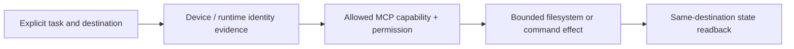

# Fork qualification notes — remote desktop and filesystem operations

**Scope:** public fork of Desktop Commander MCP. This note concerns source review, capability boundaries and safe interoperability, **not** any device credentials or live remote access.

The project exposes filesystem, terminal and remote-machine operations through MCP. Read-only inspection, file mutation, process execution and authenticated device control are different authorities. A registered connector with a device name is not proof of the intended owner machine, filesystem path or account identity.

Qualification requires absolute path confinement, ACL/UID semantics, duplicate-safe writes, no unauthorized network hops, command and output bounds, negative path traversal tests and independent effect verification. Metered remote tooling cannot silently supersede qualified free/native routes. Keep secrets, personal files and device addresses out of public examples. Retain upstream MIT license/attribution; no source or device permissions are changed by this note.
